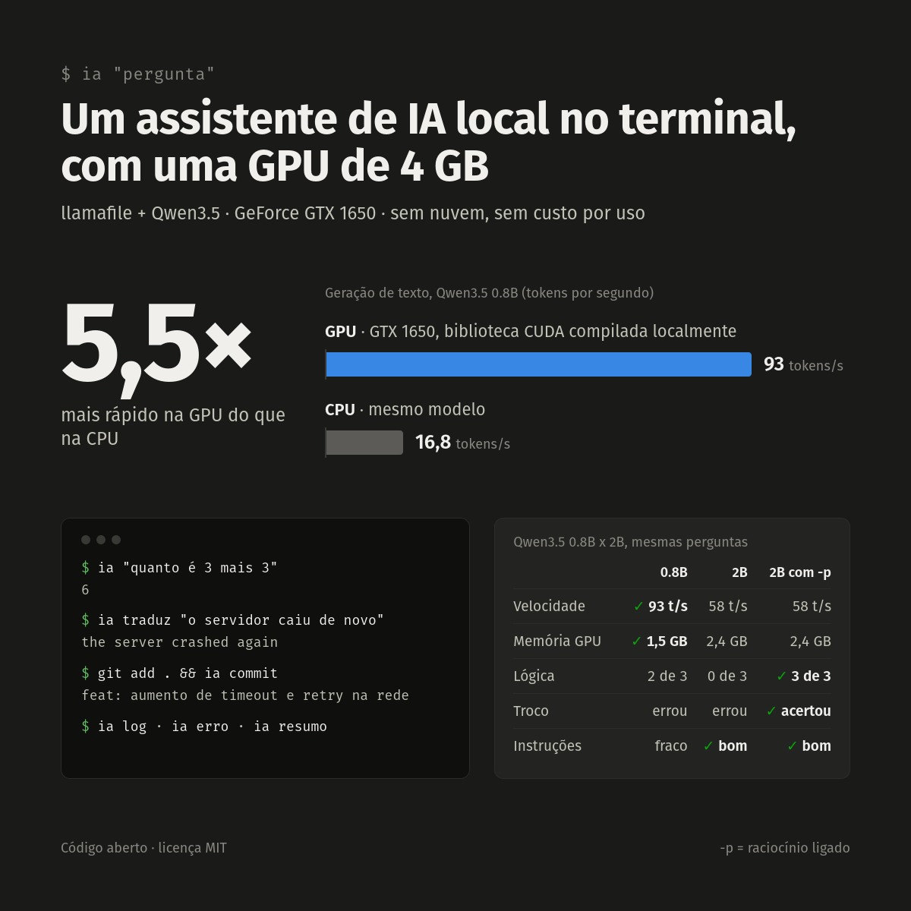

# ia: um assistente de IA local no seu terminal

Pergunte, mande arquivos por pipe e use atalhos para o dia a dia. Tudo roda **na sua
máquina**, com um modelo de linguagem local: sem nuvem, sem chave de API e sem custo por uso.

```console
$ ia "quanto é 3 mais 3"
6

$ cat relatorio.txt | ia "quais são os riscos citados?"
...

$ git add . && ia commit
feat: aumentar timeout e adicionar retries

ia: [c]ommitar, [e]ditar antes, [S]air:
```

<!-- Demonstração: grave seguindo demo/roteiro.md, salve como docs/demo.gif e descomente:

-->


Inspirado no `fm` da Apple. Usa o [llamafile](https://github.com/mozilla-ai/llamafile)
(Mozilla) como motor e o [Qwen3.5](https://huggingface.co/Qwen) como modelo padrão.

## Recursos

- **Pergunta direta ou por pipe:** `ia "pergunta"`, `cat arquivo | ia "pergunta"`, `ia "..." < arquivo`
- **Atalhos prontos:** `commit`, `log`, `cmd`, `explica`, `erro`, `resumo`, `traduz`, `corrige`
- **Atalhos seus:** em um arquivo `.ini`, sem programar
- **Modo `-p` (pensar):** liga o raciocínio do modelo quando a pergunta pede lógica ou conta
- **Rápido depois da primeira pergunta:** o modelo fica carregado na GPU (~0,1 s para responder)
- **Seguro:** nada é executado sem a sua confirmação, e o servidor só escuta em `127.0.0.1`
- **Um único arquivo Python,** sem dependências além da biblioteca padrão

## Resultados

Medido em um notebook com **GTX 1650 de 4 GB**:

| | Qwen3.5 0.8B | Qwen3.5 2B | 2B com `-p` |
|---|---|---|---|
| Velocidade (tokens/s) | ~93 na GPU, ~17 na CPU | ~58 | igual, mas gera o raciocínio antes |
| Memória da GPU | ~1,5 GB | ~2,4 GB | ~2,4 GB |
| Lógica simples (3 tentativas) | 2 acertos | 0 acertos | **3 acertos** |
| Conta de troco | errou | errou | **acertou** |
| Seguir instruções (traduzir, formato) | fraco | bom | bom |

Os modelos pequenos são ótimos em tarefas curtas e bem definidas (traduzir, resumir,
corrigir, explicar, sugerir commits), mas não fazem milagre: gerar comandos complexos e
raciocinar exigem `-p` ou um modelo maior.

## Requisitos

- Linux x86-64 com `python3` e `curl`
- Opcional: GPU NVIDIA. Sem GPU, roda na CPU (`gpu = disable` no config).

## Instalação

```bash
git clone https://github.com/Andreazo2016/ia-terminal.git
cd ia-terminal
./install.sh --baixar      # instala e baixa o Qwen3.5-2B (~2,9 GB)
```

Para o `ia erro` saber qual comando falhou, adicione ao `~/.bashrc`:

```bash
[ -f ~/.config/ia/ia.bash ] && source ~/.config/ia/ia.bash
```

Teste:

```bash
ia "quanto é 3 mais 3"
```

> **GPU NVIDIA não reconhecida?** Se o llamafile disser que o suporte a `--gpu nvidia`
> não está disponível, a causa costuma ser a glibc do sistema. Veja [docs/gpu.md](docs/gpu.md);
> o script `scripts/compilar-cuda.sh` resolve.

## Uso

```bash
ia "pergunta"                    # pergunta livre
cat arquivo | ia "pergunta"      # com conteúdo
ia -p "17% de 340?"              # raciocina antes (mais lento, acerta mais)
ia atalhos                       # lista os atalhos

ia --status | --parar | --log | --config | --ajuda
```

### Atalhos

| Atalho | O que faz |
|---|---|
| `ia commit` | lê o `git diff --staged` e os commits recentes, sugere a mensagem e pergunta: commitar, editar ou sair |
| `ia log [serviço]` | explica os erros recentes do sistema (`journalctl`), ou de um serviço |
| `ia cmd "pedido"` | gera um comando e pergunta: executar, editar ou não |
| `ia explica "comando"` | explica parte por parte e diz se é perigoso |
| `ia erro` | explica o último comando que falhou (ou `comando 2>&1 \| ia erro`) |
| `ia resumo < arquivo` | resumo em até 5 tópicos |
| `ia traduz "texto"` | português ↔ inglês |
| `ia corrige < texto` | corrige o português, mantendo o tom |

O Tab completa os atalhos, e `ia log <Tab>` completa com os serviços do systemd.

### Criando atalhos

Edite `~/.config/ia/atalhos.ini`. O arquivo tem a explicação de cada chave e exemplos:

```ini
[sql]
descricao = gera uma consulta SQL (PostgreSQL)
entrada = texto
pedido = Escreva a consulta SQL para este pedido.
sistema = Responda só com a consulta SQL, sem explicações e sem markdown.
```

```bash
ia sql "clientes que compraram mais de 3 vezes este mês"
```

Um atalho pode receber texto, rodar um comando e usar a saída (`entrada = comando`),
pedir confirmação para executar (`acao = executar`) ou para commitar (`acao = commit`).

## Como funciona

```
ia "pergunta"
  │
  ├─ servidor em 127.0.0.1:8085 respondendo?  não → sobe o llamafile em modo
  │                                                 servidor (API compatível com a
  │                                                 da OpenAI), na GPU, em segundo plano
  │
  └─ POST /v1/chat/completions (stream) → imprime a resposta enquanto chega
```

- O servidor fica carregado até `ia --parar`, por isso só a primeira pergunta espera o modelo carregar.
- O raciocínio (`<think>`) do Qwen fica desligado por padrão, para respostas diretas. O `-p` o liga só naquela pergunta.
- Os arquivos seguem o padrão XDG:

```
~/.local/bin/ia                    o comando
~/.config/ia/config.ini            configuração (modelo, porta, GPU, contexto...)
~/.config/ia/atalhos.ini           seus atalhos
~/.config/ia/ia.bash               gancho do bash para o 'ia erro'
~/.local/share/ia/modelos/         modelos (.llamafile/.gguf) e ggml-cuda.so
~/.local/state/ia/                 PID e log do servidor
```

### Trocar de modelo

Coloque outro `.llamafile` (ou `.gguf`) em `~/.local/share/ia/modelos/`, ajuste
`modelo` em `~/.config/ia/config.ini` e rode `ia --parar`. Há outros modelos prontos em
[mozilla-ai/llamafile_0.10](https://huggingface.co/mozilla-ai/llamafile_0.10). Com 4 GB
de GPU, os de até ~4B parâmetros cabem.

## Privacidade e segurança

- O modelo roda localmente; nenhum texto sai da máquina.
- O servidor escuta só em `127.0.0.1`.
- `ia cmd` e `ia commit` só agem depois da sua confirmação, feita pelo terminal.
- O gancho do bash grava só o último comando com erro e o código de saída, nunca a saída do comando.

## Desinstalar

```bash
./install.sh --remover     # mantém configuração e modelos
```

## Créditos

- [llamafile](https://github.com/mozilla-ai/llamafile), da Mozilla, e [llama.cpp](https://github.com/ggml-org/llama.cpp): motor de inferência
- [Qwen3.5](https://huggingface.co/Qwen), da Alibaba: modelos
- Inspiração: `fm`, da Apple

## Licença

[MIT](LICENSE)
